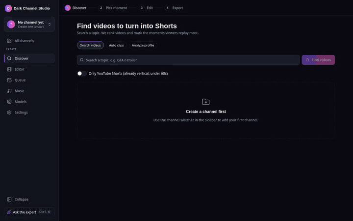
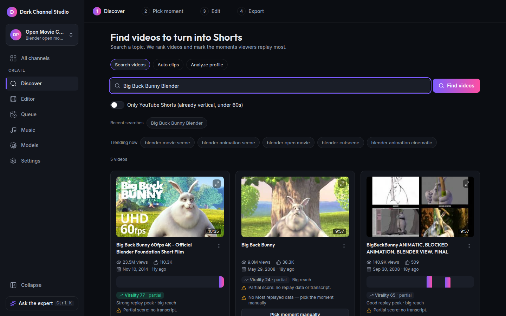
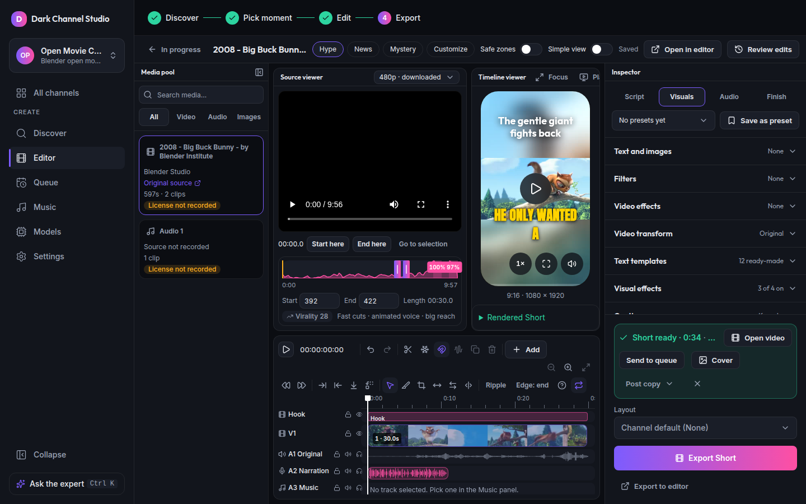
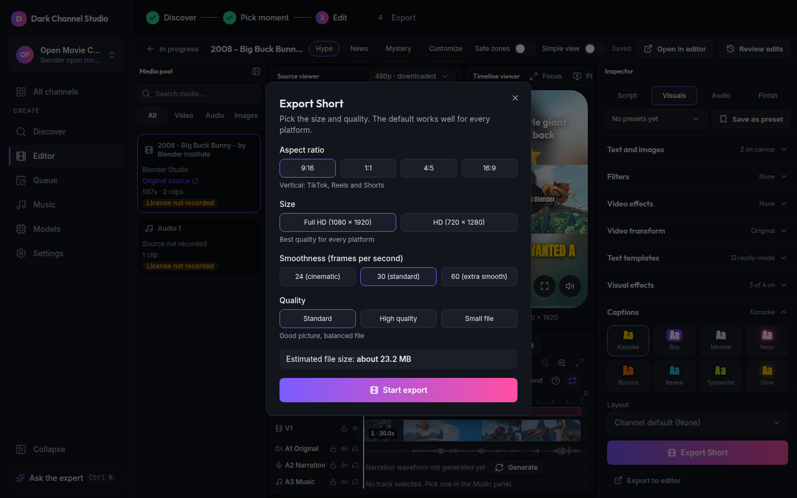
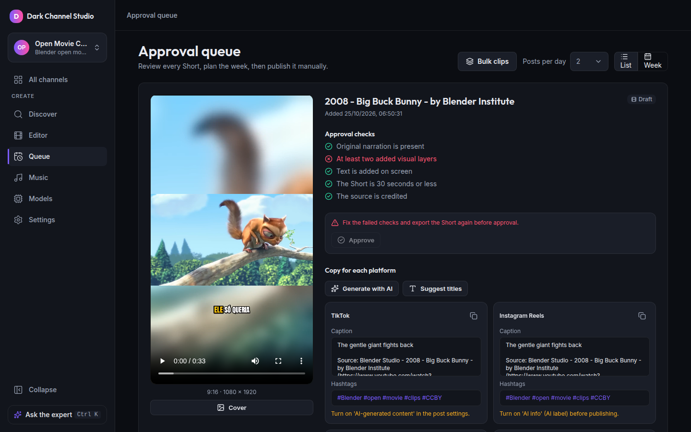

# Dark Channel Studio

A local studio for running faceless short-video channels: find viral source videos, cut the best moments into vertical Shorts, edit them with AI narration and captions, and approve them for TikTok and Instagram Reels.

This repository is a showcase of the app's screens and features. The source code is not public.

## Features

### Discover and find the moment
Search YouTube for a topic and rank videos by views, likes and recency. For each video the studio reads the "Most replayed" heatmap, detects peak windows and scores them with a virality signal. When a video has no replay data, you pick the moment manually.

### Edit like a video editor
A multi-track timeline with a media pool, source and timeline viewers, and an inspector for script, visuals, audio and finish. Includes AI narration, word-level animated captions, music with ducking, filters, reframing and text overlays.

### Export with sensible defaults
Pick aspect ratio, size, frame rate and quality, and see an estimated file size before you render.

### Approve before anything is published
Every Short goes through an approval queue with per-platform captions and hashtags (TikTok, Instagram Reels), transformation checks and a mandatory AI-disclosure confirmation. Publishing is manual by default.

_Screenshots use "Big Buck Bunny" (c) Blender Foundation, www.bigbuckbunny.org, licensed CC-BY 3.0, as demo content._

### More
- Multiple isolated channels, each with its own accounts, settings and data.
- AI story pipeline for original episodes: series bible, script, images and voices, then render.
- Expert chat agent in the app that evaluates niches and operates the studio for you.
- Auto clips: turn a long video or an upload into ranked clip suggestions.
- Edit by text, filler-word removal and caption translation.

## Responsible use

Reusing third-party video is the main risk of this kind of tool. The studio is built around transformation, not reposting:

- Every clip stores its source (video id, channel, URL) and music license.
- Transformation checks (original narration, added visual layers, on-screen text, short length, source credit) must pass before approval.
- AI-generated narration or visuals require a confirmed AI-disclosure label.
- Publishing requires manual approval by default.

## License

All rights reserved. The screenshots and GIFs are shared for showcase only.
